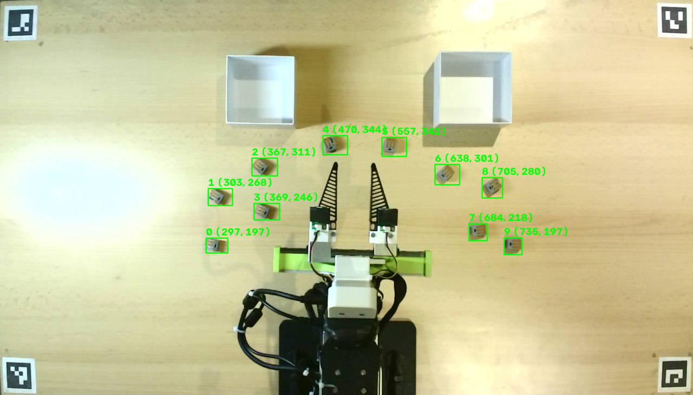
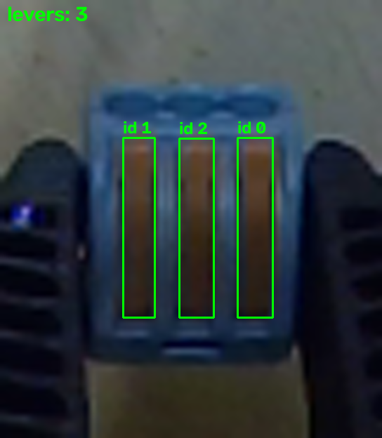
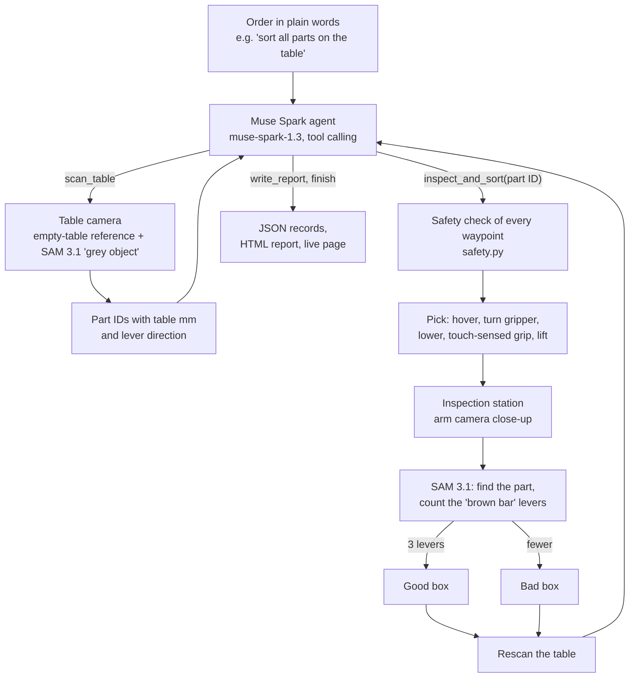
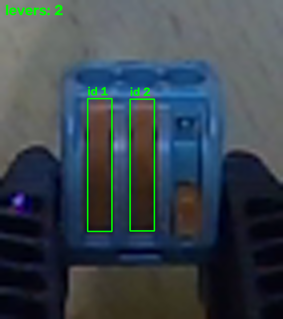
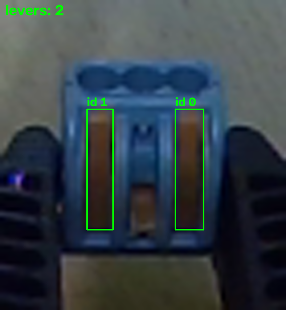

# muse-qc-cell


**Demo page (replay of a real run):** https://stefanrohringer.github.io/muse-qc-cell/

An AI quality inspection cell for injection-molded parts. A low-cost
reBot Arm B601-DM picks each part from the table, a Muse Spark agent
decides every step, SAM 3.1 counts the levers in a close-up, and the
part goes into the good box or the bad box. Real hardware, no simulation.

<!-- VIDEO: add the demo video link here on Mon 2 Nov, e.g. "Demo video (3 min): <link>". -->

<p align="center">


</p>

*Left: the table camera finds every part and gives the arm its position in table millimeters. Right: a part held between the touch-sensing fingers in front of the arm camera; SAM 3.1 finds the part, the crop is enlarged and the levers are counted: 3 levers = good.*

## The problem

I have worked in plastic injection molding for 18 years. I founded an
injection molding company and later sold it. In many plants, people
still check molded parts by eye, part after part. It is monotonous work,
and it often decides when a machine can run unattended.

The rule for a good part is usually simple and fits in one sentence. For
the connectors in this demo it is: **good = all 3 levers present,
otherwise bad.** This project shows that a desktop arm, two cameras and
Meta models can follow such a rule end to end, with little setup and on a
hackathon budget.

Who it is for: small and mid-sized molding plants that cannot pay for a
dedicated vision inspection system, for example to keep an inspection
cell running over a weekend.

## Results (real hardware, measured)

All numbers come from human-run tests, recorded in `docs/DEVLOG.md`.

### Sorting runs with 10 parts

| Run | What changed | Gripped on the first try | Sorted correctly | Time | Meta API cost |
| --- | --- | --- | --- | --- | --- |
| 30 Oct, run 1 | first 10-part run, close-up right after the lift | 10/10 | not checked: 5 parts on the left half read 0 levers (light), so they were sorted bad without a count | 7 min 20 s, about 44 s per part | 0.22 USD (about 2 cents per part, 14 Muse Spark calls) |
| 31 Oct, run 3 | lever direction from the slot axis, rescan after every part, fixed inspection station | 9/9 | **10/10** (9 in this agent run plus 1 single pick just before it; boxes checked by hand) | about 6.5 min, about 43 s per part | not measured (the credits page did not load) |

Run 2 (31 Oct, first run with the inspection station) gripped 10/10, but
several parts were gripped along the wrong axis because the lamp shadow
fooled the lever direction. That led to the slot axis fix used in run 3.

### Building blocks

| Check | Result |
| --- | --- |
| Table camera calibration | RMS reprojection error 0.199 px (26 images) |
| Lever direction from the table camera (7 parts vs. photo) | 7/7 within about 10 deg with the slot axis (before: 3/7) |
| Control loop | 100 Hz, cycle period 10.09 ms mean, 10.20 ms max |
| Grip | touch contact on both fingers before the lift, every grip of run 3 on the first try |
| Offline test suite | 848 tests, no hardware, camera or network needed |

## How it works



1. **Order:** I type an order in plain words. The Muse Spark agent decides
   which tool to call next: `scan_table`, `inspect_and_sort(part_id)`,
   `write_report` or `finish`.
2. **Scan:** the table camera finds four ArUco markers and maps pixels to
   table millimeters with a checkerboard calibration. An empty-table
   reference shows what changed, SAM 3.1 confirms each candidate, and the
   lever direction is read from the dark slot at one end of the part.
3. **Pick:** the arm moves above the part, turns the gripper so the fingers
   close across the levers, lowers, closes until the touch sensors report
   contact on both sides, and lifts.
4. **Inspect:** the arm carries the part to a fixed inspection station.
   The arm camera takes a close-up, SAM 3.1 finds the part, the crop is
   enlarged and SAM 3.1 counts the levers. Exactly 3 levers = good. A
   doubtful count is retried on fresh frames; a part is only good when
   the count is confirmed.
5. **Sort:** the part is dropped into the good or bad box, the arm returns
   to rest, and the table is scanned again, so a part that moved is
   found again.
6. **Report:** every step is saved as JSON, and a live page in the browser
   shows the table, each part's close-up, its lever count and its box.

### Where Meta AI is used

| Meta tool | Where | What it does |
| --- | --- | --- |
| Muse Spark (`muse-spark-1.3`, Meta Model API) | `muse_qc/agent/agent.py` | The agent: reads the order, picks the next tool, reacts to failures and rescans, writes the summary |
| SAM 3.1 (`sam-3.1`, Meta Model API) | `muse_qc/vision/find_parts.py`, `muse_qc/vision/vision_sam.py` | Confirms parts on the table image |
| SAM 3.1 | `muse_qc/inspection/count_clips.py`, `muse_qc/inspection/count_retry.py` | Finds the held part and counts its levers in the close-up |
| Muse Code (powered by Muse Spark) | the whole repository | Wrote all the code, logged task by task in `docs/MUSE_CODE_LOG.md` |

### A real agent run (excerpt)

From run 3 on 31 Oct (`docs/DEVLOG.md`, output shortened):

```text
agent -> scan_table()
tool: 8 parts found
grip yaw: lever 119.3 deg, offset -19.9 deg
inspect: levers 3 verdict good
tool: rescan found 7 parts
grip yaw: lever 102.3 deg, offset +9.9 deg
inspect: levers 2 verdict bad
...
tool: rescan found no parts, call scan_table
agent -> scan_table()
tool: no parts found
agent -> write_report()
agent finished: Sorted 9 parts: 6 good (3 levers), 3 bad (<3 levers), 0 failures/missed grips. Final rescan found no parts.
```

## Inspection images

Close-ups from the arm camera. SAM 3.1 boxes only closed levers; an open
lever does not count.

| Good | Bad | Bad |
| --- | --- | --- |
|  |  |  |
| 3 closed levers: good | right lever open, 2 counted: bad | middle lever open, 2 counted: bad |

## Safety

Every layer below is in the code and covered by offline tests.

1. **Plan check before motion:** `safety.py` checks every waypoint of a
   move (workspace box, minimum tool height, joint limits, joint 6 cable
   limit, speed and step size) before the motors are enabled. One refused
   waypoint stops the whole move before it starts.
2. **Check in every control cycle:** during the move, each command is
   checked again against fresh joint readings.
3. **Human gate:** `--execute` needs a typed "yes". Only a human operator
   starts hardware runs, with a hand on the power supply switch.
4. **Limited speed:** motor speed caps, ramps with limited acceleration,
   20 mm/s on the final approach.
5. **Tracking guard:** if a joint falls too far behind its command, the
   move is aborted and the arm ramps back.
6. **Touch sensing:** unexpected contact while lowering stops the descent
   and the arm moves back up. A part counts as held only with contact on
   both fingers.
7. **Grasp floor:** only the grasp waypoints may go down to 4 mm above the
   table; every other waypoint stays at least 30 mm above it.
8. **Agent limits:** the model passes part IDs only, never coordinates or
   motor commands. Positions come from our own scan. Hard limits on model
   calls, sorts, tries per part and consecutive failures. Ctrl+C stops the
   run safely.
9. **Devices:** found by USB ID, never by port order.

### Not certified

muse-qc-cell is a hackathon research prototype. Its safety layers are
software checks only. They have not been assessed or certified by any
testing body (for example TÜV), and the cell does not comply with the EU
Machinery Regulation (EU) 2023/1230 or robot safety standards such as
ISO 10218. There is no certified emergency stop, no guarding and no risk
assessment. Do not use it in production or near people without a proper
safety concept, risk assessment and certification.

## What is new in this hackathon

I started this repository from scratch during the hackathon. Everything
in `muse_qc/`, `tests/`, `docs/` and `calibration/` was written during the
event.

Prior work, declared and not part of this submission: my Touch-Sensing
Fin-Ray Gripper (hardware and firmware). I built it before the hackathon,
and it is listed in the official Seeed reBot-DevArm repository under
"DIY Soft Finger". New in this hackathon: `muse_qc/gripper/gripper.py`, which reads
the gripper sensors over USB. See `docs/THIRD_PARTY.md`.

## Quickstart

1. Clone this repository.
2. `make setup`: prepares `../seeed-sdk` and syncs the environment.
3. `make test`: runs the offline test suite, no hardware needed.
4. Optional, for the agent with the fake table: `cp .env.example .env`,
   add your key, then `make simulate`.

or with Docker: `make docker`

## Run it

Prerequisites: Linux, Python 3.11, `uv`, the Seeed SDK checked out next to
this repository as `../seeed-sdk` (see `docs/SETUP.md`; without it
`uv sync` fails), and a `.env` file with `MODEL_API_KEY` for the camera and
model steps.

`scripts/setup_sdk.sh` covers SETUP steps 1 to 3, so a fresh clone only
needs the script plus `uv sync` (step 4):

```bash
bash scripts/setup_sdk.sh                        # prepares ../seeed-sdk, idempotent
uv sync
uv run pytest                                     # offline suite, no hardware
uv run python -m muse_qc.checks.preflight                # human only: USB + SDK checks
uv run python -m muse_qc.checks.model_check              # human only: Model API check
uv run python -m muse_qc.vision.find_parts --save-empty  # human only: empty-table reference
uv run python -m muse_qc.agent                    # real Muse Spark, fake table, no arm
uv run python -m muse_qc.agent --execute --chat --task "sort all parts"  # human only: real run
```

Without local setup, the same offline suite runs in Docker:

```bash
docker build -t muse-qc-cell .
docker run --rm muse-qc-cell
```

The live page is written to `recordings/live.html`; open it in a browser
to watch the run. Every hardware step is described in `docs/SETUP.md`
with its recorded output.

## Repository

| Path | What |
| --- | --- |
| `muse_qc/agent/` | Muse Spark agent loop, tools, chat orders, live page |
| `muse_qc/vision/` | cameras, markers, calibration, table scan and lever direction |
| `muse_qc/inspection/` | lever count, records, HTML report |
| `muse_qc/arm/` | arm access, safety checks, pose solving |
| `muse_qc/gripper/` | gripper sensors and motor |
| `muse_qc/pick/` | pick, inspection station, sort |
| `muse_qc/checks/` | USB, SDK config and Model API checks |
| `muse_qc/bringup/` | hand-run arm bringup scripts |
| `tests/` | offline test suite |
| `docs/SETUP.md` | every hand-run step with recorded output |
| `docs/DEVLOG.md` | dated log of every real hardware and API test |
| `docs/RESULTS.md` | verified numbers |
| `docs/MUSE_CODE_LOG.md` | what Muse Code built in each task |

## Known limits

- Missing and open levers were seen in the tests; broken levers are not
  tested yet.
- SAM 3.1 does not always confirm a real part on the first try; a second
  phrase and the rescan catch most of them.
- Light matters: a lamp shadow once turned the lever direction by 90 deg,
  and poor light gave 0 levers on good parts. The fixed inspection station
  and the slot axis fixed this in run 3.
- After every part the arm returns to rest, which costs about 7 s per part.

## Next

- A longer test series with known good and bad parts, including broken
  and open levers.
- Go straight from the box to the next part without returning to rest.
- Measure the Meta API cost of a full run again.
- Other parts with other rules, given in plain words.

## Credits

Built during the Meta Global AI Developer Hackathon (26 Oct to 4 Nov 2026).

- **Meta models:** Muse Spark 1.3 and SAM 3.1 through the Meta Model API;
  Muse Code (powered by Muse Spark) wrote the code.
- **Hardware:** reBot Arm B601-DM by Seeed Studio, Orbbec Gemini 305 on the
  arm, a USB webcam above the table, and my pre-existing Touch-Sensing
  Fin-Ray Gripper ([repository](https://github.com/StefanRohringer/Touch-Sensing-Fin-Ray-Gripper)).
- **Software (dependencies, not copied in):** Seeed `reBotArm_control_py`
  (MIT), `motorbridge` (MIT), Pinocchio (BSD-2-Clause), OpenCV
  (Apache-2.0), the `openai` Python client for the Meta Model API
  (Apache-2.0), NumPy (BSD-3-Clause), pySerial (BSD), pytest (MIT), uv.
  Details and versions: `docs/THIRD_PARTY.md`.
- **Ideas:** the public Meta workshop repository
  `meta-models/legal-agent-workshop` (checks inside tools, agent loop with
  hard limits; ideas only, no code copied).

## License

MIT, see `LICENSE`. Third-party components: `docs/THIRD_PARTY.md`.
